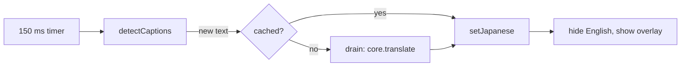

# Live Caption Design

## Caption Translation
- Input: Udemy caption cues (`[data-purpose="captions-cue-text"]`) inside the largest visible `<video>`
- Output: A fixed overlay (`#udemy-ja-caption-overlay`) with the Japanese text; `html.udemy-ja-caption-hide-source` hides the English cues
- Code: `caption.js` → `detectCaptions()`, `drain()`, `setJapanese()`, `positionUI()`, `start()`, `stop()`; `translator.js` → `translate()`
- Spec: [Live Caption](../../specs/caption/10-live-caption.md#requirements)
- Architecture: [Overview](../../architecture/10-overview.md#caption-flow)

Steps:
1. Every 150 ms, `detectCaptions()` joins the visible cues into one source text (`desired`)
2. A new source clears the Japanese text (English shows again) and starts `drain()`, unless it is cached or failed before
3. `drain()` translates one text at a time through the shared core (dictionary applied) and keeps going while `desired` changes; an outdated result is cached but not shown
4. `setJapanese()` shows the Japanese text, then hides the English cues
5. `positionUI()` keeps the button at the video's top right and the overlay at the cue position, with Udemy's caption font size (15-28 px)

- Start: `core.onReady()` calls `start()` unless `localStorage.udemyJapaneseCaptionOff` is "1". The button click also calls `start()`; it passes a progress callback so the button shows the model download percent
- Stop: hides the overlay and shows the English cues again. The translator stays, because the quiz shares it
- Fullscreen: the button and overlay move into the fullscreen element; native video fullscreen keeps the English captions
- The resolved texts are kept in a local map (250 entries) so a repeated cue shows at once; failed texts are not retried until the captions are restarted
- Console helpers: `window.udemyJapaneseCaption.start()`, `stop()`, `destroy()`

Scenario:
- Input: Lecture "Final Exam Tips" with English CC, model installed
- Steps: Page load → core ready → `start()` → cue "You can make sure..." → `drain()` → `setJapanese()`
- Result: Japanese overlay over the video, English cue hidden, button reads 日本語字幕 オフ ×
- All scenarios: [Live Caption Scenarios](../../testing/scenarios/caption/10-live-caption.md#live-caption-scenarios)
