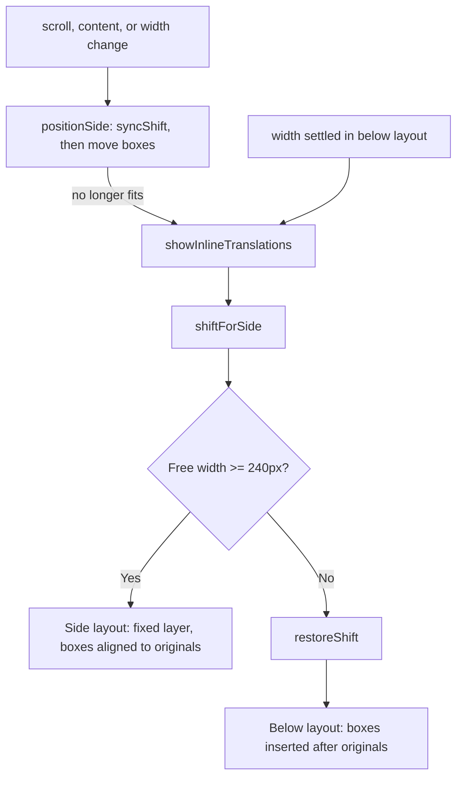

# Inline Translation

## Layout Selection
Translations are shown to the right of the original when there is room, otherwise below it.
- Input: Answer cards, the nearest scroll container of the cards
- Rule: Free width = scroll container right edge (or viewport) − rightmost card edge − 2 × 16px, measured after the column shift. Side layout when it is at least 240px; box width is the original column width (at least 560px), limited by the free width
- Code: `content.js` → `showInlineTranslations()`, `shiftForSide()`, `sideColumn()`, `scrollParentOf()`
- Architecture: [Overview](../../architecture/10-overview.md#translation-flow)

Representative scenario:
- Input: 1600px wide window, quiz column 640px, curriculum sidebar on the right
- Steps: `sideColumn()` finds free space inside the main scroll container → `showSideTranslations()`
- Result: Each translation floats to the right of its original and stops before the sidebar
- All scenarios: [Inline Translation Scenarios](../../testing/scenarios/quiz/10-inline-translation.md#inline-translation-scenarios)

## Column Shift
Udemy centers the quiz column, which leaves the left half of the free space unused.
- Code: `centeredColumn()`, `shiftTarget()`, `shiftForSide()`, `syncShift()`, `applyShift()`, `restoreShift()`
- `centeredColumn()` walks up from the first card to the scroll container and picks the innermost ancestor that contains the header and all cards and whose left and right gaps inside its parent are equal (within 4px) and larger than 40px. This covers margin auto, flex, and grid centering
- `shiftForSide()` sets only `margin-left` and `margin-right: auto` (inline, `!important`) so the original plus its translation are centered as a pair, with at least 24px left margin
- The previous inline values are saved and restored by `clearInlineTranslations()`, the below fallback, and `destroy()`
- `positionSide()` calls `syncShift()` on every reposition. When the free width changed, the margin is recalculated in place from the shifted column's current margin (the shifted column is no longer centered, so `centeredColumn()` cannot find it). With no shift yet, `shiftForSide()` applies one, for example when Udemy finishes centering after the first render. Only when Udemy re-rendered the column or dropped the override is the layout rebuilt

Observed on Udemy (2026-11-04): `div.quiz-page-layout--scroll-container` is the scroll container; its child (860px) is centered with `margin: 24px auto`. With the curriculum sidebar closed (1751px area) the pair needs 1752px, so the column moves to the 24px minimum margin.

Scenario:
- Input: 2308px wide main area, 688px quiz column centered with 810px on each side
- Steps: `centeredColumn()` finds `#content` → pair width 688 + 32 + 688 → margin-left 450px
- Result: Original at 450px, translation right after it, both centered; no inline style left after `destroy()`

## Layout Diagnosis
`window.udemyJapaneseQuiz.layoutInfo()` returns the mode, the shifted element, the scroll container, and each ancestor of the first card with width, gaps, display, justify-content, margins, and overflow. Use it when the side placement looks wrong on a real Udemy page.

## Side Layout
- Code: `showSideTranslations()`, `positionSide()`, `relayout()`, `requestRelayout()`
- A `position: fixed` layer (`.uqt-side-layer`, marked with `data-udemy-quiz-inline`) is clipped to the visible part of the scroll container, so boxes never cover a sidebar or the page header
- Each box's top follows its original (`getBoundingClientRect().top`). When a box is taller than its original, the next box is pushed down 8px below it
- Scroll (capture), content changes, and width changes reposition boxes once per animation frame, without removing them
- Width changes: `watchWidths()` puts a `ResizeObserver` on every ancestor of the first card, because the element that changes width when Udemy's sidebar opens or closes differs between pages. Only width changes count, so our own boxes (which change heights) do not trigger it. In the side layout each change calls `requestRelayout()`, so the shift and boxes follow the sidebar animation frame by frame. When the side layout no longer fits, `positionSide()` returns false and the layout is rebuilt as below
- In the below layout the boxes flow with the page by themselves; the layout is rebuilt once, 150ms after the width stops changing, in case the side layout now fits
- Window resize only repositions; its width change reaches the observer
- An empty spacer (`data-udemy-quiz-inline="spacer"`) after the last answer grows by the amount the boxes overflow below it. Without it, boxes below a short quiz would be clipped and unreachable because the container had nothing to scroll
- Udemy elements are never moved; only the column margins are overridden (see Column Shift) and our own nodes are added. Text color, font family, and font size are copied from the first card

## Below Layout
- Input: `quiz` from `extractQuiz()`, translated question, translated answers
- Output: `.udemy-quiz-inline-translation` elements inserted into the Udemy DOM, each marked with `data-udemy-quiz-inline`
- Code: `content.js` → `showInlineTranslations()`, `makeInlineTranslation()`, `clearInlineTranslations()`
- Steps: Remove previous inline nodes → insert the question translation before the first card → insert each answer translation after its card
- An `<li>` card gets an `<li>` translation so `<ul>`/`<ol>` stay valid
- Architecture: [Overview](../../architecture/10-overview.md#translation-flow)

## Avoiding Self Detection
Injected nodes must not be read back as quiz text or trigger re-translation.
- `findText()` skips text inside inline nodes
- `originalInnerText()` hides inline nodes while reading `innerText`
- The question range clone removes inline nodes before reading text
- `isOwnMutation()` ignores mutations caused by inline nodes

## Re-insertion
Udemy can replace answer elements with identical text. If the content key is unchanged
but the cards are new, `inlineIsCurrent()` returns false and the cached translations
are inserted again without calling the translator. If the cards are current, the side
boxes are only repositioned, because feedback text can change card heights.

Scenario:
- Input: User selects an answer and Udemy re-renders the cards with the same text
- Steps: Observer fires → same key → `inlineIsCurrent()` false → `showInlineTranslations()` with `lastRendered`
- Result: Translations stay visible, no extra translation call

## Answer Scope Without a Footer
- Input: A practice test page with a "Question N:", "질문 N:" or "質問 N:" heading but no "Question N of M" footer
- Output: Only the answer controls inside the `data-testid="mc-quiz-question"` form
- Code: `content.js` → `extractQuiz()`
- Steps: When the form contains the heading or comes after it, answer controls outside the form are ignored. Without this, the course content list below the quiz adds its completion checkboxes, the count passes 12, and the page is skipped.
- Scenario: MLA-C01 practice test, question 1 with five checkbox answers and fifteen course content checkboxes below → five answers are found and translated
- All scenarios: [Inline Translation Scenarios](../../testing/scenarios/quiz/10-inline-translation.md#answer-scope-without-a-footer)

## Exam Form Fallback
- Input: A quiz page with no "Question N:" heading (exam-style pages), where the answer form has `data-testid="mc-quiz-question"`
- Output: The same quiz object as the heading path, with `number` set to `"form"`
- Code: `content.js` → `extractFormQuiz()`, `readAnswers()`; `extractQuiz()` falls back to it when no heading is found
- Steps: The form's text before the first answer is the question; each answer's card is read by `readAnswers()`; the form is the header anchor for placement
- Scenario: Form text "Which service scales EC2?" followed by four radio answers → question and four answers are translated
- Limit: Not yet verified on a real exam page; the question text must be in the form before the first answer

## Exam Result Page
- Input: The result page after submitting a practice exam, where `[class*="question-result--question-result"]` exists
- Output: One translation box after each text block: question body (`.rt-scaffolding`), each answer body, the answer feedback, and the question explanation (`[class*="result-pane--question-related-fields"]`)
- Code: `content.js` → `extractExamResult()`, `updateExam()`; `update()` uses it when no quiz is found
- Steps: Read each block's text → translate with the existing cache and dictionary → insert a box after each block element
- Dedup: The key is the list of source texts; the same key is not rendered again
- Selectors: Checked on one CCAR-F practice exam result page only; other exam types are not verified
- Limit: Exam-taking pages are not supported yet
