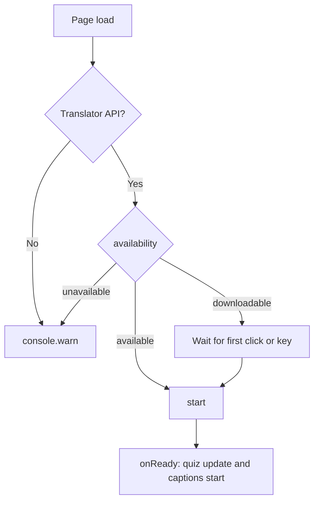

# Startup

## Automatic Start
- Input: Page load on a Udemy URL
- Output: A ready `translator`, or a console message explaining why it did not start
- Code: `translator.js` → `autoStart()`, `startOnFirstGesture()`, `start()`, `onReady()`
- The translator is shared: the quiz (`content.js`) and the captions (`caption.js`) wait for `onReady()` instead of creating their own
- Architecture: [Overview](../../architecture/10-overview.md#translation-flow)

`Translator.availability()` decides the path:

| Availability | Action |
| --- | --- |
| `available` | Create the translator immediately |
| `downloadable`, `downloading` | Wait for the first `pointerdown` or `keydown` on the page, then create it (a download requires user activation) |
| `unavailable` or API missing | Log a warning and stay idle |

Scenario:
- Input: New PC, model not downloaded, user opens a Udemy quiz
- Steps: `availability()` returns `downloadable` → listeners registered → user clicks an answer → `Translator.create()` downloads the model → `schedule(true)`
- Result: Inline translations appear after the download; progress is logged in the console

## Console Helpers
`window.udemyJapaneseQuiz` exposes `start()`, `refresh()`, `layoutInfo()`, and `destroy()`; `window.udemyJapaneseCaption` exposes `start()`, `stop()`, and `destroy()`.
