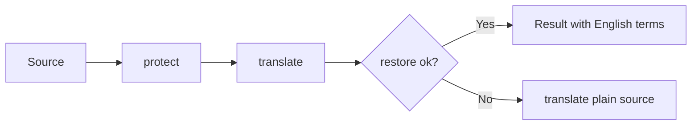

# Dictionary Design

## Placeholder Substitution
- Input: Source English text
- Output: Japanese translation with terms without a meaning in their original English form, and terms with a meaning replaced by that meaning
- Code: `dictionary.js` → `protect()`, `restore()`; `translator.js` → `translateWithDictionary()`, `translate()` (used by the quiz and the captions)
- Data: rows from `dictionary.json` (dictionary branch, see [Dictionary Sync](30-dictionary-sync.md)), or the bundled list in `dictionary-terms.js` → `window.__udemyQuizTranslatorTerms` (`groups`, `caseSensitive`) when that file cannot be used
- Spec: [Dictionary](../../specs/translation/20-dictionary.md#requirements)
- Architecture: [Overview](../../architecture/10-overview.md#translation-flow)

Steps:
1. `protect()` replaces each term with `[[n]]`, in text order, and returns the original surface texts and, for terms with a meaning, the meaning
2. The translator translates the text with placeholders
3. `restore()` puts back the meaning when there is one, otherwise the English text. Extra brackets the translator adds (`[[[0]]`) are absorbed
4. If any placeholder is missing, `restore()` returns `null` and the plain source is translated instead



Representative scenario:
- Input: "Launch an EC2 instance in a private subnet with an IAM role."
- Steps: `protect()` → "Launch an [[0]] [[1]] in a [[2]] with an [[3]]." → translate → `restore()`
- Result: "private subnetでEC2 instanceをIAM roleと一緒に起動します。"
- All scenarios: [Dictionary Scenarios](../../testing/scenarios/translation/20-dictionary.md#dictionary-scenarios)

## Placeholder Format
`[[n]]` was chosen after testing on Chrome 157: it survived 15 tokens in a long text. `X0X` and `ZQ0ZQ` were lowercased, and `⟦n⟧` was corrupted. Source text that already contains `[[n]]` is translated without the dictionary.

## Rows and Configuration
- `configure(rows)` rebuilds the matcher from `[{ word, meaning?, exact? }]`. Called without arguments, it uses the bundled list (`bundledRows()`)
- `normalizeRows()` trims words and merges duplicates: `exact` is kept if any duplicate has it, and a meaning is kept if any duplicate has one
- Meaning lookup: the exact spelling first, then case-insensitive with collapsed whitespace, then the same with a trailing `s`/`es` removed
- Acronyms (no lowercase letters) always match case-sensitively

## Matching
- One regex for all terms, sorted longest first
- Case-insensitive terms use the inline `(?i:...)` modifier (Chrome 125+; the extension requires 138+)
- Terms marked `exact` and acronyms match only with the exact casing
- Boundaries: no letter, digit, or `_` on either side; spaces in a term match any whitespace
- A trailing `s`/`es` is matched after a term ending in a letter

## Data Format (version 2)
`dictionary.json` on the `dictionary` branch:
```json
{ "version": 2, "terms": [ { "word": "Claude", "exact": true }, { "word": "private subnet", "meaning": "プライベートサブネット" }, { "word": "Lambda" } ] }
```
The bundled list in `dictionary-terms.js` was converted to this format once (1,597 entries in the bundled lists became 1,583 rows after merging duplicates). A comparison of 7 sample sentences showed identical output for the bundled list and the converted file.

## Term File Layout
`dictionary-terms.js` has `caseSensitive` (product names that are ordinary words in lowercase) and `groups` (`claude`, `awsServices`, `awsConcepts`, `ccarF`, `general`). It is the fallback when `dictionary.json` cannot be used. Avoid everyday English words such as "object", "request", "continue", or "summary", which would stay untranslated everywhere. Add inflected forms that are not plurals explicitly ("deterministically").

## Known Limits
Japanese particles are chosen by the translator around the placeholder, so after restoring the sentence may read slightly unnaturally (e.g. "Claude extended thinkingを"). For terms with a meaning the meaning replaces the placeholder, and the particle the translator attached to the placeholder (e.g. "は/が") stays after the meaning.
